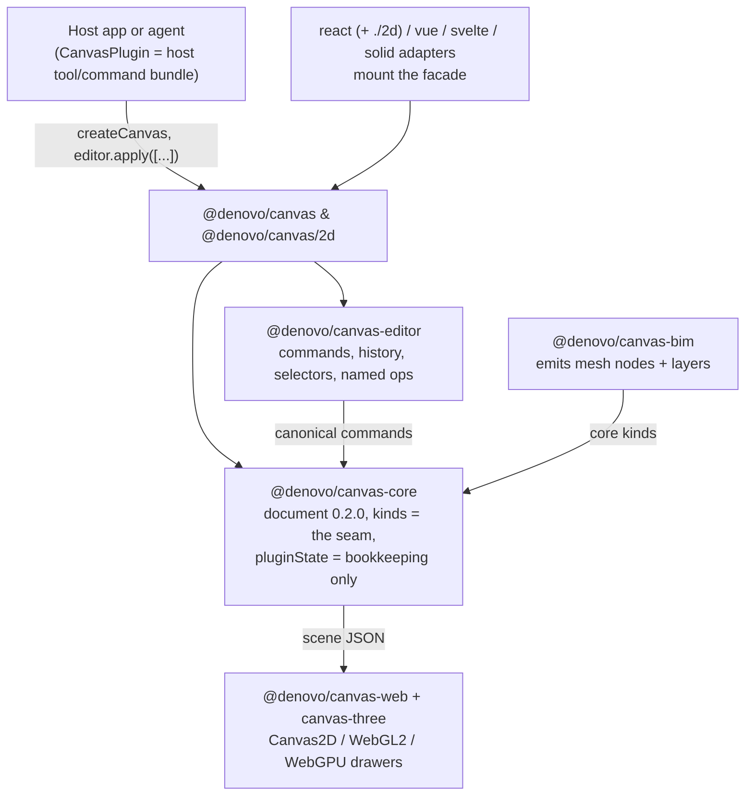

# Denovo Canvas

Denovo Canvas is a framework-agnostic TypeScript SDK for building fast,
editable 2D and 3D canvas applications. Like TanStack Table and TanStack
Virtual for DOM interfaces, Denovo Canvas owns the hard parts behind a small
headless core and thin framework adapters: viewport culling, spatial indexing,
HTML overlay virtualization, GPU draw-call batching, rAF frame coalescing,
fine-grained selector subscriptions, command/transaction undo-redo, and
renderer-independent JSON persistence.

Your app supplies the UI controls, design system, and storage destination. Use
the same editor and document model from vanilla JavaScript, React / Next.js,
Vue, Svelte, or Solid.

## What You Can Build Today

- **Large 2D infinite canvases, diagrams, boards, and annotation editors**
  - Built-in 2D nodes: `rect`, `circle`, `edge` (straight, quadratic curve,
    orthogonal port routing with arrowheads), `text`, `html` (host-rendered
    DOM cards with zoom scaling and off-screen culling), `group`, `measurement`,
    `annotation`, and custom `plugin.<org>.<kind>` drawers.
  - Automatic uniform-grid spatial indexing and viewport culling for rendering,
    hit-testing, and marquee selection (`getNodesInBounds`), O(visible) HTML
    overlay DOM virtualization + diffed `renderNode` updates, O(1) cached
    minimap rendering, rAF input burst coalescing, and optional 2D WebGPU with
    GPU-resident vertex/atlas caching.
  - Three.js-free 2D entrypoints across the facade and all four framework
    adapters (`@denovo/canvas/2d`, `@denovo/canvas/react/2d`,
    `@denovo/react-canvas/2d`, `@denovo/vue-canvas/2d`,
    `@denovo/svelte-canvas/2d`, `@denovo/solid-canvas/2d`) keep 3D engine code
    completely out of 2D application bundles.
- **High-performance 3D viewers, editors, and BIM workflows**
  - Built-in 3D nodes: `box`, `sphere`, `mesh` (inline or external geometry
    asset blobs), `instances`, `group`, `measurement`, `annotation`, and
    official `plugin.denovo.field`.
  - Automatic `auto` backend resolution (WebGPU preferred when available,
    otherwise WebGL2), opt-in draw-call instancing (`render.batch: true`) for
    top-level boxes and spheres with BVH raycast picking, distance-based sphere
    LOD, section planes, analytic box/mesh surface placement & measurement,
    Web Worker geometry conversion (`@denovo/canvas/worker`), chunked scene
    streaming (`createSceneChunkLoader`), and optional multi-model IFC
    federation (`@denovo/canvas-bim`).
- **Fine-grained framework state subscriptions (zero hover churn)**
  - Headless `subscribeCanvasSelector` + `shallowEqual` plus thin native
    bindings for React (`useCanvasSelector` via `useSyncExternalStore`), Vue
    (`useCanvasSelector` returning `ComputedRef`), Svelte
    (`createCanvasSelectorStore` `$store`), and Solid (`useCanvasSelector`
    returning `Accessor`).
- **Standardized editing, named operations, and persistence**
  - Canonical `0.2.0` JSON documents (with deterministic `0.1.0` migration),
    validated commands, atomic transactions, bounded undo/redo history, built-in
    tools (`Select`, `Pan/Orbit`, `Transform` with axis/plane handles,
    `Connector`, `2D Shape`, `3D Primitive`, `3D Surface Placement`,
    `Distance Measurement`, `Annotation`), 20 shared Named Operations for host
    UIs and AI agents (`setLayerVisible`, `setNodeVisible`, `removeEdge`,
    `removeNode`, `stackBox`, `listNodes`, etc.), and memory, filesystem, and
    IndexedDB storage adapters.

## Quick Start

### 1. Lightweight 2D editor (`@denovo/canvas/2d` — zero Three.js)

Give the page a stage with a height and controls:

```html
<div id="stage" style="height: 320px"></div>
<button id="hide">Hide rectangle</button>
<button id="undo">Undo</button>
```

Create a 2D document, connect the editor, and run named operations:

```ts
import {
  connectEditorToCanvas,
  createCanvas,
  createEditor,
  defineDocument,
  setNodeVisible
} from "@denovo/canvas/2d";
import "@denovo/canvas/styles.css";

const documentModel = defineDocument({
  id: "drawing",
  scene: {
    id: "page",
    mode: "2d",
    layers: [{ id: "shapes", name: "Shapes" }],
    nodes: [
      {
        id: "rect",
        type: "rect",
        layerId: "shapes",
        position: [40, 40],
        size: [120, 80],
        fill: "#22c55e"
      }
    ]
  }
});

const editor = createEditor({ document: documentModel });
const canvas = createCanvas("#stage", { document: documentModel, editable: true });
await canvas.ready;
const disconnect = connectEditorToCanvas(editor, canvas);

document.querySelector("#hide")!.addEventListener("click", () =>
  editor.apply([setNodeVisible({ nodeId: "rect", visible: false })])
);
document.querySelector("#undo")!.addEventListener("click", () => editor.undo());

// On unmount: disconnect(); canvas.destroy();
```

### 2. React / Next.js 2D view with fine-grained selectors

Use `@denovo/canvas/react/2d` (or `@denovo/react-canvas/2d`) so 2D React apps
never bundle Three.js, React Three Fiber, or Drei, and toolbar components skip
re-renders during high-frequency canvas hover events:

```tsx
"use client";

import {
  connectEditorToCanvas,
  createEditor,
  defineDocument,
  shallowEqual
} from "@denovo/canvas/2d";
import { Canvas2DView, useCanvasSelector } from "@denovo/canvas/react/2d";
import "@denovo/canvas/styles.css";
import { useMemo } from "react";

export function Board() {
  const editor = useMemo(
    () =>
      createEditor({
        document: defineDocument({
          id: "board",
          scene: {
            id: "scene",
            mode: "2d",
            layers: [{ id: "default", name: "Default" }],
            nodes: [
              {
                id: "card-1",
                type: "rect",
                layerId: "default",
                position: [40, 40],
                size: [160, 88],
                fill: "#38bdf8"
              }
            ]
          }
        })
      }),
    []
  );

  // Re-renders only when document or undo/redo booleans actually change —
  // 0 re-renders across pointermove hover churn.
  const documentModel = useCanvasSelector(editor, (s) => s.document);
  const { canUndo, canRedo } = useCanvasSelector(
    editor,
    (s) => ({ canRedo: s.history.canRedo, canUndo: s.history.canUndo }),
    shallowEqual
  );

  return (
    <div>
      <Canvas2DView
        scene={documentModel.scene}
        onRuntime={(runtime) => {
          if (runtime) {
            void runtime.ready.then(() => connectEditorToCanvas(editor, runtime));
          }
        }}
      />
      <button disabled={!canUndo} onClick={() => void editor.undo()}>
        Undo
      </button>
      <button disabled={!canRedo} onClick={() => void editor.redo()}>
        Redo
      </button>
    </div>
  );
}
```

### 3. Vue, Svelte, Solid, and Vanilla selectors

```ts
// Vanilla / any runtime
import { shallowEqual, subscribeCanvasSelector } from "@denovo/canvas/2d";
const stop = subscribeCanvasSelector(
  editor,
  (s) => ({ canUndo: s.history.canUndo, canRedo: s.history.canRedo }),
  (next) => console.log(next),
  { equals: shallowEqual }
);

// Vue 3 (@denovo/vue-canvas or Three.js-free @denovo/vue-canvas/2d) — auto-disposes with effectScope
import { useCanvasSelector } from "@denovo/vue-canvas/2d";
const undoDepth = useCanvasSelector(editor, (s) => s.history.undoDepth);

// Svelte (@denovo/svelte-canvas or Three.js-free @denovo/svelte-canvas/2d) — standard $store contract
import { createCanvasSelectorStore } from "@denovo/svelte-canvas/2d";
const selectedId = createCanvasSelectorStore(editor, (s) => s.selection.primaryId);

// Solid (@denovo/solid-canvas or Three.js-free @denovo/solid-canvas/2d) — auto-disposes with onCleanup
import { useCanvasSelector } from "@denovo/solid-canvas/2d";
const undoDepthSignal = useCanvasSelector(editor, (s) => s.history.undoDepth);
```

### 4. Dynamic 2D + 3D scenes (`@denovo/canvas`)

Import from the root `@denovo/canvas` entrypoint when your app renders 3D scenes
or switches dynamically between 2D and 3D:

```ts
import { createCanvas } from "@denovo/canvas";
import "@denovo/canvas/styles.css";

const canvas = createCanvas("#stage", {
  scene: {
    id: "scene-3d",
    mode: "3d",
    layers: [{ id: "default", name: "Default" }],
    render: { batch: true },
    nodes: [
      { id: "box-1", type: "box", layerId: "default", position: [0, 0, 0], color: "#22c55e" },
      { id: "box-2", type: "box", layerId: "default", position: [2, 0, 0], color: "#22c55e" }
    ]
  }
});
```

### Working Examples

- [Release board (2D cards, connectors, save/reset on `@denovo/canvas/2d`)](./apps/playground-flow/src/main.ts)
- [Service map (2D graph layouts on `@denovo/canvas/2d`)](./apps/playground-network/src/main.ts)
- [Next.js mask editor (React `Canvas2DView` + `useCanvasSelector` + shadcn/Tailwind v4)](./apps/playground/app/mask-host.tsx)
- [Vanilla 2D/3D authoring workbench](./apps/vanilla/src/main.ts)
- [3D Warp Field hero showcase](./apps/playground-field/src/main.ts)

## Measured Performance And Bundle Impact

Verified by deterministic repository scripts (`pnpm verify:2d-performance`,
`pnpm verify:performance`, `pnpm verify:selectors`, `pnpm verify:public-api`):

| Surface / Workload | Optimization | Measured Result |
| --- | --- | --- |
| 2D `10k-2d-rects` (Canvas2D + minimap) | Spatial index + viewport culling + O(1) minimap cache | `drawCalls` 10,001 → **28**, pan p50 3.70 ms → **0.00 ms**, 200 hit-tests 118.5 ms → **0.5 ms** |
| 2D `10k-2d-webgpu` (explicit 2D WebGPU) | GPU-resident vertex/atlas/bindGroup cache + spatial culling | pan p50 6.90 ms → **0.00 ms**, p95 14.40 ms → **0.10 ms**, triangles 20,002 → **210** |
| 2D `1k-2d-overlays` (HTML cards) | O(visible) DOM virtualization + diffed `rebuildObjects` | pan p50 0.80 ms → **0.10 ms**, 1-card edit calls `renderNode` **1×** (not 1,001×) |
| 2D rapid wheel burst (20 events / tick) | rAF frame coalescing | 20 events → **1 Canvas2D render** with full accumulated pan delta |
| React / Vue / Headless selectors | `useCanvasSelector` / `subscribeCanvasSelector` + `shallowEqual` | **0 spurious re-renders** across 100 hover updates |
| 3D `1k-boxes` / `10k-boxes` / `1k-spheres` | `render.batch: true` instancing + BVH picking (Metal WebGL2) | `drawCalls=1`, `geometries=1`, **8.30 ms p50** (under 16 ms GPU gate) |
| 2D-only production bundle (`playground-flow`, `playground-network`) | `@denovo/canvas/2d` (zero Three.js / WebGPU) | **1.87 MB → 352–361 kB** (**-80.6% to -81.2%**, 0 B Three.js) |

*(3D hardware GPU timings are measured on macOS Apple Silicon ANGLE Metal; 2D
Canvas2D culling, HTML diff, rAF coalescing, selector isolation, and all
browser showcase suites also run on Linux `ubuntu-latest` in GitHub Actions CI.)*

## Architecture

```text
Humans and AI agents write the same three things: a kind with JSON
properties, a named operation, and the document itself.
                                   |
+----------------------------------v----------------------------------+
| HOST APP    vanilla / Next.js / Vue / Svelte / Solid / agent host   |
|                                                                     |
| CanvasPlugin = host bundle: per-canvas tools + private plugin.*     |
| commands. Plumbing for one host. NOT the product extension seam.    |
+----------------------------------+----------------------------------+
                                   |  createCanvas / createEditor
                                   |  editor.apply([ namedOp, ... ])
+----------------------------------v----------------------------------+
| @denovo/canvas (full)  |  @denovo/canvas/2d (Three.js-free 2D)      |
+-----------------+-----------------------------------+---------------+
                  |                                   |
+-----------------v----------------+  +---------------v---------------+
| @denovo/canvas-core              |  | @denovo/canvas-editor         |
| document schema 0.2.0 (JSON)     |  | commands, transactions,       |
|                                  |  | undo/redo, selection, tools,  |
| KINDS  =  THE EXTENSION SEAM     |  | subscribeCanvasSelector       |
|  built-in: rect, box, mesh, edge |  |                               |
|  plugin.<owner>.<kind> registry  |  | NAMED OPERATIONS              |
|  official: plugin.denovo.field,  |  |   setLayerVisible, stackBox,  |
|    sparkline, and shade          |  |   setFieldPattern, listNodes, |
|                                  |  |   (document) -> { document,   |
| pluginState = bookkeeping only.  |  |     changed, commands }       |
|  Nothing draws from here.        |  | compile to canonical commands |
+-----------------+----------------+  +-------------------------------+
                  |  scene JSON
+-----------------v---------------------------------------------------+
| RUNTIMES draw the document                                          |
|   @denovo/canvas-web    Canvas2D / WebGL2 / WebGPU, kind drawers    |
|   @denovo/canvas-three  Three.js helpers, the official field drawer |
+---------------------------------------------------------------------+

OPTIONAL ENGINES are packages that emit core kinds (not plugins)
  @denovo/canvas-bim     IFC -> mesh nodes + storey layers + metadata
  diagram                edge / text / html are built-in 0.2.0 kinds
FRAMEWORK ADAPTERS mount the facade (adapter -> facade, never back)
  @denovo/react-canvas (incl. ./2d), vue-canvas, svelte-canvas, solid-canvas
SERVER / WORKER
  @denovo/canvas-server  storage adapters replay canonical commands
  @denovo/canvas-worker  heavy parsing off the main thread
```

Kinds and named operations are the extension seam. `CanvasPlugin` is a
per-canvas bundle of host tools and commands, and `pluginState` never carries
a visual. Why, and what not to build next:
[Extension Surface Decision](./docs/extension-surface-decision.md).



## Packages And Subpaths

| Package / Subpath | Role |
| --- | --- |
| `@denovo/canvas` | Full 2D/3D facade (`createCanvas`, `createEditor`, tools, named operations, selectors, `./styles.css`, `./worker`, `./indexed-db`, `./react-query`, `./web`, `./react`, `./react/2d`). |
| `@denovo/canvas/2d` | Lightweight 2D-only facade with zero `three`, `three/webgpu`, or `three-mesh-bvh` imports. |
| `@denovo/canvas-core` | Headless `0.2.0` document/scene/command/storage/plugin schemas and validation. |
| `@denovo/canvas-editor` | Framework-independent command dispatcher, transactions, undo/redo, tools, named operations, and `subscribeCanvasSelector` / `shallowEqual`. |
| `@denovo/canvas-web` | Browser 2D (Canvas2D + 2D WebGPU) and 3D (WebGL2 + WebGPU) runtimes, spatial index, overlay virtualization, and `./2d` / `./3d` / `./indexed-db` subpaths. |
| `@denovo/canvas-three` | Three.js optimization helpers (demand rendering, instancing, BVH raycasting, official field drawer). |
| `@denovo/react-canvas` | React adapter (`CanvasView`, `CanvasStage3D`, `useCanvasSelector`) plus `./2d` (`Canvas2DView`, `useCanvasSelector` without Three.js/R3F/Drei). |
| `@denovo/vue-canvas` | Vue 3 adapter (`DenovoCanvas`, `useCanvasSelector`) plus Three.js-free `./2d` (`DenovoCanvas2D`, `useCanvasSelector`). |
| `@denovo/svelte-canvas` | Svelte adapter (`DenovoCanvas`, `createCanvasSelectorStore`) plus Three.js-free `./2d` (`DenovoCanvas2D`, `createCanvasSelectorStore`). |
| `@denovo/solid-canvas` | Solid adapter (`DenovoCanvas`, `useCanvasSelector`) plus Three.js-free `./2d` (`DenovoCanvas2D`, `useCanvasSelector`). |
| `@denovo/canvas-server` | Server-side scene storage adapters and optimistic conflict-checked persistence. |
| `@denovo/canvas-worker` | Web Worker task queue and off-main-thread geometry conversion. |
| `@denovo/canvas-bim` | Optional BIM contracts and `./web-ifc` multi-model IFC parser adapter. |

## Development And Verification

```sh
pnpm install
pnpm build
pnpm typecheck

# Deterministic verification suites
pnpm verify:docs
pnpm verify:public-api
pnpm verify:pack-smoke
pnpm verify:document-schema
pnpm verify:editor-core
pnpm verify:hit-testing
pnpm verify:selectors
pnpm verify:2d-performance
pnpm verify:flow-showcase
pnpm verify:network-showcase
pnpm verify:diagram-rendering
pnpm verify:region-mask

# Local example dev servers
pnpm dev --filter @denovo/canvas-flow-example
pnpm dev --filter @denovo/canvas-vanilla-example
pnpm dev --filter @denovo/canvas-next-playground
```

## License And Governance

Denovo Canvas is licensed under the [Apache License 2.0](./LICENSE).
See [NOTICE](./NOTICE) for copyright and third-party notes.

- [Changelog](./CHANGELOG.md)
- [Contributing](./CONTRIBUTING.md)
- [Code of Conduct](./CODE_OF_CONDUCT.md)
- [Security policy](./SECURITY.md)

## Design Documents

- [Contributor Operating Policy](./docs/contributor-operating-policy.md)
- [Contributor Rules](./docs/contributor-rules.md)
- [Contributor Automation](./docs/contributor-automation.md)
- [Project Status](./docs/project-status.md)
- [Product Identity](./docs/product-identity.md)
- [Framework Surface](./docs/framework-surface.md)
- [Extension Surface Decision](./docs/extension-surface-decision.md)
- [Named Authoring Operations](./docs/named-authoring-operations.md)
- [M4 Performance Thresholds](./docs/m4-performance-thresholds.md)
- [M0 Product Contract](./docs/m0-product-contract.md)
- [M3 Authoring Contract](./docs/m3-authoring-contract.md)
- [M8 Diagram Contract](./docs/m8-diagram-contract.md)
- [Public API Contract](./docs/public-api-contract.md)
- [Architecture](./docs/architecture.md)
- [Rendering Backend Strategy](./docs/rendering-backend-strategy.md)
- [Vision and Milestones](./docs/vision-and-milestones.md)
- [Editing Model](./docs/editing-model.md)
- [Persistence and Sync](./docs/persistence-and-sync.md)
- [Extensibility](./docs/extensibility.md)
- [Developer Experience](./docs/developer-experience.md)
- [Dependency Strategy](./docs/dependency-strategy.md)
- [Better Auth Style Architecture](./docs/better-auth-style-architecture.md)
