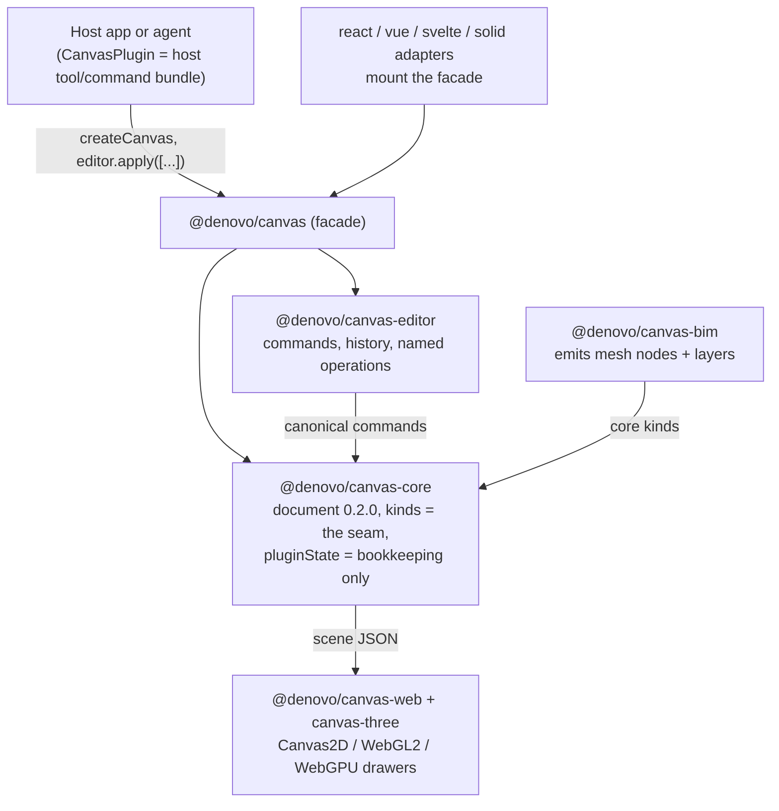

# Denovo Canvas

Denovo Canvas is a TypeScript framework for building web editors for 2D and
3D documents. The editor owns document changes, selection and undo history.
The runtime draws the document. Your app supplies the controls and decides
when and where to save. Use the same editor from vanilla JavaScript, React,
Vue, Svelte or Solid.

## Your first edit

Give the page a stage with a height and a button:

```html
<div id="stage" style="height: 320px"></div>
<button id="hide">Hide rectangle</button>
<button id="undo">Undo</button>
```

Create one document, connect its editor to the stage, and wire the controls:

```ts
import {
  connectEditorToCanvas, createCanvas, createEditor, defineDocument, setNodeVisible
} from "@denovo/canvas";
import "@denovo/canvas/styles.css";

const documentModel = defineDocument({
  id: "drawing",
  scene: {
    id: "page", mode: "2d",
    layers: [{ id: "shapes", name: "Shapes" }],
    nodes: [{
      id: "rect", type: "rect", layerId: "shapes",
      position: [40, 40], size: [120, 80], fill: "#22c55e"
    }]
  }
});
const editor = createEditor({ document: documentModel });
const canvas = createCanvas("#stage", { document: documentModel });
await canvas.ready;
const disconnect = connectEditorToCanvas(editor, canvas);

document.querySelector("#hide")!.addEventListener("click", () =>
  editor.apply([setNodeVisible({ nodeId: "rect", visible: false })])
);
document.querySelector("#undo")!.addEventListener("click", () => editor.undo());

// When the stage unmounts, call disconnect() and canvas.destroy().
```

For pointer-driven selection, moving and drawing, see the
[vanilla editor](./apps/vanilla/src/main.ts). The
[Next.js mask editor](./apps/playground/app/mask-host.tsx) uses the same
operations to drive a React view and a separate mask preview.

## Architecture

```text
Humans and AI agents write the same three things: a kind with JSON
properties, a named operation, and the document itself.
                                   |
+----------------------------------v----------------------------------+
| HOST APP    vanilla / Next.js / Vue / Svelte / Solid / agent host   |
|                                                                     |
| CanvasPlugin = host bundle: per-canvas tools + private plugin.*     |
| commands. Plumbing for one host. NOT the product extension seam.    |
+----------------------------------+----------------------------------+
                                   |  createCanvas / createEditor
                                   |  editor.apply([ namedOp, ... ])
+----------------------------------v----------------------------------+
| @denovo/canvas    facade: the default import, re-exports the seam   |
+-----------------+-----------------------------------+---------------+
                  |                                   |
+-----------------v----------------+  +---------------v---------------+
| @denovo/canvas-core              |  | @denovo/canvas-editor         |
| document schema 0.2.0 (JSON)     |  | commands, transactions,       |
|                                  |  | undo/redo, selection, tools   |
| KINDS  =  THE EXTENSION SEAM     |  |                               |
|  built-in: rect, box, mesh, edge |  | NAMED OPERATIONS              |
|  plugin.<owner>.<kind> registry  |  |   setLayerVisible, stackBox,  |
|  official: plugin.denovo.field,  |  |   setFieldPattern, listNodes, |
|    and plugin.denovo.sparkline   |  |   (document) -> { document,   |
|                                  |  |     changed, commands }       |
| pluginState = bookkeeping only.  |  | compile to canonical commands |
|  Nothing draws from here.        |  |                               |
+-----------------+----------------+  +-------------------------------+
                  |  scene JSON
+-----------------v---------------------------------------------------+
| RUNTIMES draw the document                                          |
|   @denovo/canvas-web    Canvas2D / WebGL2 / WebGPU, kind drawers    |
|   @denovo/canvas-three  Three.js helpers, the official field drawer |
+---------------------------------------------------------------------+

OPTIONAL ENGINES are packages that emit core kinds (not plugins)
  @denovo/canvas-bim     IFC -> mesh nodes + storey layers + metadata
  diagram                edge / text / html are built-in 0.2.0 kinds
FRAMEWORK ADAPTERS mount the facade (adapter -> facade, never back)
  @denovo/react-canvas, vue-canvas, svelte-canvas, solid-canvas
SERVER / WORKER
  @denovo/canvas-server  storage adapters replay canonical commands
  @denovo/canvas-worker  heavy parsing off the main thread
```

Kinds and named operations are the extension seam. `CanvasPlugin` is a
per-canvas bundle of host tools and commands, and `pluginState` never carries
a visual. Why, and what not to build next:
[Extension Surface Decision](./docs/extension-surface-decision.md).

The same structure for GitHub's diagram renderer:



## Package Shape

- `@denovo/canvas`: default user-facing facade for quick setup, CSS/theme
  contract, plugin registration surface, and framework-agnostic web runtime.
- `@denovo/canvas-core`: headless scene schema, Zustand vanilla store, shared
  types, validation, document contracts, editing command contracts, storage
  contracts, and plugin contracts.
- `@denovo/canvas-editor`: framework-independent command dispatcher, selection,
  history, tools, transactions, and the persistence event bus.
- `@denovo/canvas-web`: framework-agnostic browser runtime for native 2D Canvas
  and Three.js 3D.
- `@denovo/canvas-three`: Three.js optimization primitives such as demand render
  loops, InstancedMesh helpers, and BVH raycasting setup.
- `@denovo/react-canvas`: optional React adapter with React Three Fiber support
  and explicit delegation to `@denovo/canvas-web` for dynamic 2D/3D scenes.
- `@denovo/vue-canvas`: optional Vue 3 adapter that mounts the same
  `@denovo/canvas-web` runtime behind a reactive `DenovoCanvas` component.
- `@denovo/svelte-canvas`: optional Svelte adapter for the same web runtime.
- `@denovo/solid-canvas`: optional Solid adapter for the same web runtime.
- `@denovo/canvas-server`: server-side scene storage and validation utilities.
- `@denovo/canvas-worker`: Web Worker and OffscreenCanvas helpers.
- `@denovo/canvas-bim`: optional BIM adapter contracts and `./web-ifc` importer.

This follows the TanStack-style split: keep the core portable, keep the web
runtime framework-agnostic, then publish small adapters for each ecosystem.

## License And Governance

Denovo Canvas is licensed under the [Apache License 2.0](./LICENSE).
See [NOTICE](./NOTICE) for copyright and third-party notes.

- [Contributing](./CONTRIBUTING.md)
- [Code of Conduct](./CODE_OF_CONDUCT.md)
- [Security policy](./SECURITY.md)

## Development

```sh
pnpm install
pnpm build
pnpm dev --filter @denovo/canvas-vanilla-example
pnpm dev --filter @denovo/canvas-next-playground
```

## Design Documents

- [Contributor Operating Policy](./docs/contributor-operating-policy.md)
- [Contributor Rules](./docs/contributor-rules.md)
- [Contributor Automation](./docs/contributor-automation.md)
- [Project Status](./docs/project-status.md)
- [Extension Surface Decision](./docs/extension-surface-decision.md)
- [M4 Performance Thresholds](./docs/m4-performance-thresholds.md)
- [M0 Product Contract](./docs/m0-product-contract.md)
- [M3 Authoring Contract](./docs/m3-authoring-contract.md)
- [Public API Contract](./docs/public-api-contract.md)
- [Architecture](./docs/architecture.md)
- [Rendering Backend Strategy](./docs/rendering-backend-strategy.md)
- [Vision and Milestones](./docs/vision-and-milestones.md)
- [Editing Model](./docs/editing-model.md)
- [Persistence and Sync](./docs/persistence-and-sync.md)
- [Extensibility](./docs/extensibility.md)
- [Developer Experience](./docs/developer-experience.md)
- [Dependency Strategy](./docs/dependency-strategy.md)
- [Better Auth Style Architecture](./docs/better-auth-style-architecture.md)
